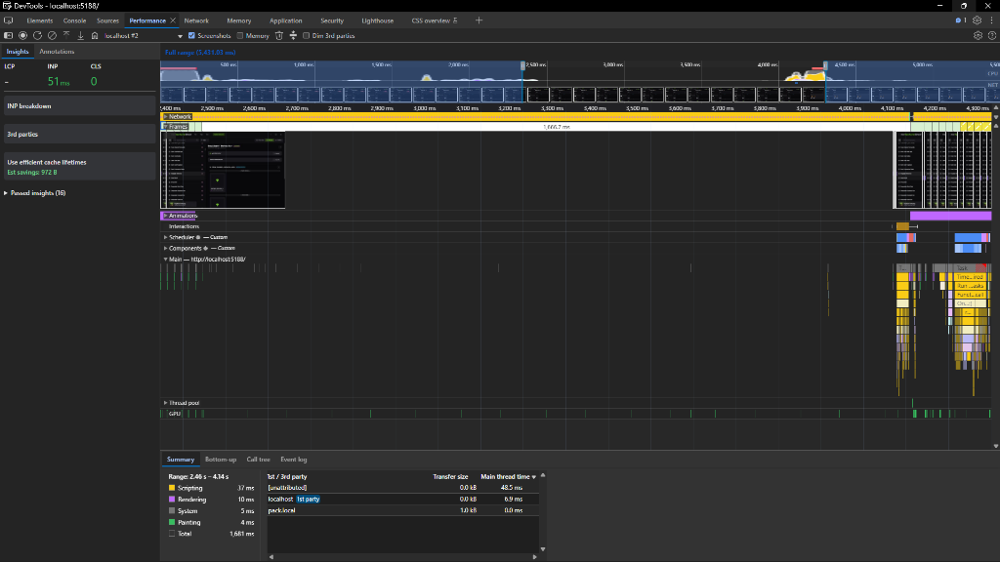
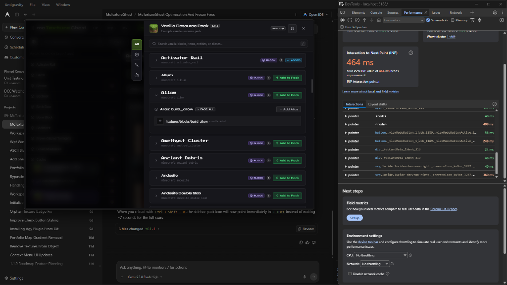
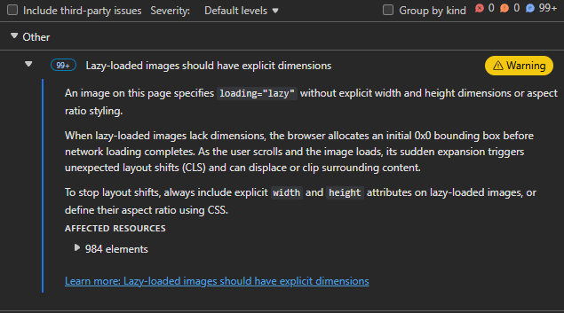

*A story about NTFS timestamps, WPF thread affinity, and why "it looked fine" was a lie.*

---

I've been building **mcTextureGhost**, a Windows desktop tool for managing Minecraft Bedrock resource packs. It's a hybrid app, a .NET WPF host process running a React frontend inside a Microsoft Edge WebView2 control, with IPC passing JSON messages between the two sides. The architecture lets me write the UI in React while keeping raw disk I/O, filesystem scanning, and JSON manifest parsing in C#.

About a week ago, I shipped what I thought was a solid performance overhaul. Filtering blocks went from laggy O(N) flatMap scans on every keystroke to instant O(1) lookups. State synchronization went from pushing multi-megabyte payloads on every change to sending delta patches. I was pretty happy with it.

Then I tried deleting a block and its terrain texture entries.

The UI froze for 4 seconds. Twitched. Then froze for another 4 seconds.

8 seconds total. A user interaction that should be 50ms is now 160× slower than before my "optimization."

This is the story of why-how that happened and how I fixed it.

---

## What the App Does

Before getting into the bug, a quick picture of the architecture, because the stack choices matter a lot here:

```
┌─────────────────────────────────┐
│      WPF / .NET Host Process    │
│  MainViewModel, PackScanner,    │
│  FileSystemWatcher, WriteJournal│
│  PackStateDiffer, IpcBridge     │
└────────────────┬────────────────┘
                 │ PostWebMessageAsJson
                 │ window.chrome.webview.postMessage
┌────────────────▼────────────────┐
│    Microsoft Edge WebView2      │
│  React 19 · Zustand-style store │
│  Three.js · CSS Modules · Vite  │
└─────────────────────────────────┘
```

The C# side watches the pack directory with `FileSystemWatcher`, parses `terrain_texture.json`, `blocks.json`, and `flipbook_textures.json`, and pushes state to React via IPC. React renders the workspace, block cards, texture slots, a 3D preview, and sends commands back when the user does something like delete an entry.

A production Bedrock resource pack has thousands of `.png` and `.tga` files, multiple JSON manifests, and hundreds of named texture aliases. Scanning it from scratch is expensive.

---

## v1.1.0: The Baseline Problems

Before the fix that broke everything, the app had real algorithmic problems:

- **Filter on every keystroke traversed every block's leaves.** The filter pipeline examined every single block and its texture leaves on every character typed, generating repeated allocations and visible performance stutter.
- **Store lookups were linear scans.** `blocks.find(b => b.blockId === id)` on every render.
- **Drag-and-drop encoded files as Base64 strings** and shipped them across WebView2 IPC, expensive on both ends.
- **Any state change pushed the entire tree** across IPC as full JSON snapshots.

These were real problems, and I addressed all of them. That part worked.

---

## v1.1.1: The Optimization Branch Ships

PR #16 (`experimental-optimization`) landed on October 4th and brought a lot of structural improvements to how the app handled state and performance. The highlights:

**Pre-computed `blockMetaMap`:** Instead of traversing leaves for every filter check, metadata about each block—whether it has pack textures, ghosts, or certain keys—was computed once per tree update:

```ts
const blockMetaMap = useMemo(() => {
  const map = new Map<string, BlockMeta>();
  for (const b of blockWorkspaceTree) {
    const allLeaves: CatalogLeafDto[] = [
      ...(b.leaves ?? []),
      ...(b.faceNodes?.flatMap(f => f.leaves ?? []) ?? []),
    ];
    map.set(b.blockId, {
      hasPackTexture: allLeaves.some(l => l.status === 'OK' || l.status === 'OVERRIDE'),
      hasGhost: allLeaves.some(l => l.status === 'GHOST'),
      searchTokens: [b.blockId, b.displayName, ...allLeaves.map(l => l.alias)].join(' ').toLowerCase(),
    });
  }
  return map;
}, [blockWorkspaceTree]);
```

Filter lookups became O(1) dictionary gets. Typing in the search bar became instant.

**Normalized store indexes:** `blocksById`, `entitiesById`, `aliasesByKey`. All pre-indexed Maps instead of linear array searches.

**`PACK:PATCH` delta protocol:** Instead of pushing the full tree, state changes were diffed and sent as minimal updates. The frontend applied patches with structural sharing so unchanged object references stayed stable and React skipped untouched subtrees.

**Native file drop:** Eliminated Base64 IPC encoding for drag-and-drop. File paths go to C# natively for direct disk copy.

**Sidebar virtualization:** Only rows visible in the viewport are mounted.

**Watcher classification & scoped rescans:** The filesystem watcher began classifying events—texture-file changes vs. JSON changes vs. structural modifications. When mutations were constrained to a single JSON file, the app triggered a `RescanBlocksScoped` that re-parsed only that file instead of re-enumerating the entire pack on disk. This method takes under 25 milliseconds instead of several seconds.

**State diffing on the background thread:** `PackStateDiffer.ComputeDiff` already ran on `Task.Run` to keep the UI thread free while comparing state graphs.

All of this worked. Filtering was fast. Patches were small. Rescans were localized. And then I tested deleting a block and its terrain entries.

---

## The Deletion Freeze

Clicking "Delete Block & Terrain Entries" triggered a visible freeze.

```
User clicks delete
  │
  ├── UI locks (WebView2 frozen)
  │   └── ~2–4 seconds
  │
  ├── Tiny twitch (< 50ms)
  │
  └── UI locks again
      └── ~2–4 seconds
```

 *DevTools trace showing a 1,666ms dead frame; the browser event loop receives zero updates while the host is scanning.*

Not once. Twice. Back to back. The renderer was completely idle during the freeze. No scripting. No layout. No network. The JS thread wasn't stuck in a loop; it was receiving nothing. No frames, no events, no input.

That meant the problem wasn't in React. It was in the host.

---

## Why the Deletion Froze

Digging in, I found two interconnected problems that v1.1.1 had not completely solved.

### Problem 1: NTFS Parent Directory Timestamp Events Leaking Through WriteJournal

When you write a file on Windows NTFS, the operating system also updates the `LastWriteTime` of the **containing folder**. This is normal NTFS behavior. `FileSystemWatcher` under the hood uses `ReadDirectoryChangesW`, and it sees both the file change and the directory change.

My `WriteJournal` was supposed to suppress self-inflicted watcher events. It recorded the file path when we wrote it, and checked that path when the watcher fired. But it only recorded the file path; not the parent directory.

When the directory event arrived, the watcher's classification logic would check `Directory.Exists(path)` → true and classify it as a structural change, kicking off a `RescanAsync()` that re-enumerated the entire pack from disk.

There was also a bug in how `IsSelfWrite` consumed tokens. It used `TryRemove`; meaning it removed the suppression entry on the first check. When NTFS fires multiple `Changed` events for the same file (which it sometimes does), the first event consumed the token and the second one slipped through as an unsuppressed change.

One write → two fires → first consumed → second triggers full rescan.

In combination with repeated writes during deletion, this pattern could repeat across multiple files.

### Problem 2: The Deletion Path Lacked Atomic Native Handling

The frontend deletion command was structured as a single IPC message, but the native side did not have a corresponding batch-delete implementation. The C# side performed block deletion and terrain alias deletion as separate JSON reads, modifications, and writes.

v1.1.1 had introduced `RescanBlocksScoped` for fast incremental rescans when changes were confined to JSON files, but the deletion interaction could still trigger the watcher multiple times during a single user action. If the journal was in a leaked/consumed state, each write could independently queue a rescan.

---

## The Investigation & Architecture

Understanding the deletion problem meant understanding WPF thread affinity. The browser engine depends on the host window's Win32 message pump. When the WPF Dispatcher thread is busy, the message pump doesn't run. WebView2 can't receive input events, can't composite frames, can't do anything. The browser just sits there, appearing frozen, because from its perspective it's been cut off from the outside world.

This meant the fix couldn't be in React—it had to be in how the host scheduled work and how it suppressed redundant filesystem events. v1.1.1 already had the pieces: scoped rescans, background diffing, watcher classification. But the deletion path was still triggering multiple rescan cycles.

---

## v1.1.2: The Fixes

Three targeted changes addressed the deletion freeze:

### Fix 1: Native Batch Deletion

Added a native handler for a new `BLOCK:DELETE_AND_TERRAIN_ENTRIES` command that deletes the block entry and all its terrain aliases in a single atomic operation:

```csharp
public static void DeleteTextureEntriesBatch(string packRoot, IEnumerable<string> aliases, string category)
{
    var aliasList = aliases.Distinct().ToList();

    // Single read → remove all → single write
    var terrainObj = LoadOrCreateTerrainTexture(packRoot);
    var texData = GetTextureData(terrainObj);
    bool changed = false;
    foreach (var alias in aliasList)
    {
        if (texData.ContainsKey(alias)) { texData.Remove(alias); changed = true; }
    }
    if (changed) SaveTerrainTexture(packRoot, terrainObj);

    // Same atomic pass for flipbook entries
    // ...
}
```

Instead of multiple writes, one command triggers one write per JSON file, regardless of how many aliases are being removed.

### Fix 2: Hardening WriteJournal Against NTFS Directory Events

Two changes to the write journal:

**Register the parent directory** whenever a file write is recorded, so that the NTFS parent timestamp update doesn't slip through:

```csharp
public static void RecordWrite(string? fullPath, TimeSpan? ttl = null)
{
    var normalized = Normalize(fullPath);
    var expiry = DateTime.UtcNow.Add(ttl ?? DefaultTtl);
    _journal[normalized] = expiry;

    // Also suppress the NTFS parent directory timestamp event
    var parent = Path.GetDirectoryName(normalized);
    if (!string.IsNullOrWhiteSpace(parent))
        _journal[Normalize(parent)] = expiry;
}
```

**Stop consuming the token on check**. Instead of `TryRemove`, use `TryGetValue` so multiple events within the TTL window all get suppressed:

```csharp
public static bool IsSelfWrite(string? fullPath)
{
    var normalized = Normalize(fullPath);
    PruneExpired();
    return _journal.TryGetValue(normalized, out var expiry)
        && DateTime.UtcNow <= expiry;
    // No TryRemove; window stays open for the full TTL
}
```

And in the watcher handler, drop directory-only events unconditionally:

```csharp
void OnFileChanged(object sender, FileSystemEventArgs e)
{
    if (e.ChangeType == WatcherChangeTypes.Changed && Directory.Exists(e.FullPath))
        return; // NTFS parent timestamp noise; discard
    QueueChange(e.FullPath, e.ChangeType.ToString());
}
```

### Fix 3: Improved Catalog Rendering & Image Loading

Reduced DOM node count and IntersectionObserver overhead by conditionally rendering catalog item groups only when their parent is expanded:

```tsx
{isExpanded && (
  <div className={`${styles.aliasGroupListWrapper} ${styles.expanded}`}>
    {/* Only mount children when expanded */}
    <div className={styles.aliasGroupListInner}>
      {/* Alias groups rendered here */}
    </div>
  </div>
)}
```

Changed thumbnail loading from `loading="lazy"` to `loading="eager"` with explicit dimensions, eliminating redundant IntersectionObserver pipelines for local virtual-host URLs.

These optimizations were discovered during investigation of the deletion freeze. While not directly causing it, they improved interaction latency when the catalog drawer was in use.

---

## Coincidental Fixes That Came Out of the Investigation

While I was in DevTools looking at the freeze, the profiler flagged some other things:

**10,000+ DOM nodes in the catalog drawer:** The drawer was rendering all alias groups and leaf rows eagerly and hiding them with CSS. Opening it mounted the entire tree at once. Interaction to Next Paint was 464ms on a fast machine.

Fix: conditional JSX rendering (`{isExpanded && (...)}`) so nodes only mount when their card is actually expanded. Initial DOM count dropped from 10,000+ to \~320 (-96.8%).


*DevTools Live Metrics showing 464ms Interaction to Next Paint (INP) latency when opening the Catalog Drawer and expanding items prior to conditional DOM rendering.*

**1,000+ IntersectionObserver instances:** Every texture thumbnail used `loading="lazy"`. Since they load from `https://pack.local/` (a virtual host mapping to local disk), they load instantly, but the browser still spun up full lazy-loading observer pipelines for each one. Switching to `loading="eager"` with `decoding="async"` eliminated all of them.


*Chromium DevTools audit warning for 984 local thumbnail elements specifying loading="lazy" without explicit width, height, or aspect-ratio styling, generating over 1,000 redundant IntersectionObserver instances.*

---

## Results

The three fixes combined had a measurable impact:

| Metric                    | v1.1.0          | v1.1.1              | v1.1.2             |
| ------------------------- | --------------- | ------------------- | ------------------ |
| Deletion freeze           | ~3,800ms        | ~8,000ms (4s + 4s)  | <100ms (imperceptible) |
| Catalog drawer DOM        | 10,000+         | 10,000+             | ~320 (-96.8%)      |
| Filter keystroke response | ~150ms stutter  | <1ms                | <1ms               |
| Scoped block rescan       | ~3,800ms        | ~3,800ms            | <25ms              |

---

## What I Learned

**1. Algorithmic fixes don't help if the pipeline around them is broken.** I made React's filtering go from O(N) to O(1). It didn't matter, because the native layer was triggering full disk scans on every user action. The frontend was fast; it just had nothing to do.

**2. On Windows NTFS, writing a file always touches the parent directory.** `FileSystemWatcher` sees both the file event and a directory event. If your suppression mechanism only records file paths, directory events will leak through and trigger whatever you have downstream. Register the parent directory too, and don't consume the token on the first check.

**3. In a WebView2 desktop app, the WPF Dispatcher IS the browser's message pump.** Blocking the Dispatcher doesn't just freeze the WPF UI; it freezes the entire WebView2 too. The browser engine can't composite frames, can't deliver input events, can't do anything until the Dispatcher is free again. Any non-trivial computation has to move to background threads before it becomes user-visible.

**4. The renderer being idle doesn't mean the frontend is fine.** I initially took idle JS execution as "React isn't the problem," which was correct; but the renderer was idle because it was cut off from the host, not because it was healthy. A renderer trace can't see the host thread. You need both perspectives to understand the full story.

**5. Never use `loading="lazy"` on virtual host URLs.** Lazy loading is designed for images that might not be visible in the viewport, loading from a slow network. Using it on local in-memory assets just adds IntersectionObserver overhead with zero benefit.

---

The fix wasn't one clever idea. It was finding where three separate systems were failing at the same intersection—unbatched mutations, a suppression journal with a blind spot, and a deficit in native deletion atomicity—and fixing each one. Once all three were addressed, the deletion freeze became imperceptible.

v1.1.2 tagged October 12th.
