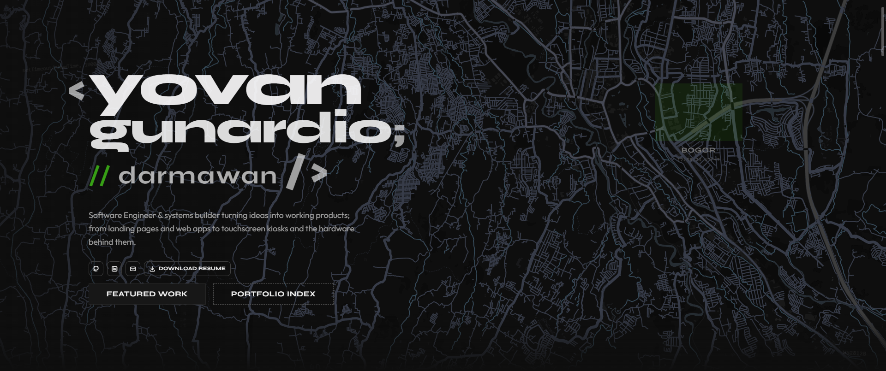
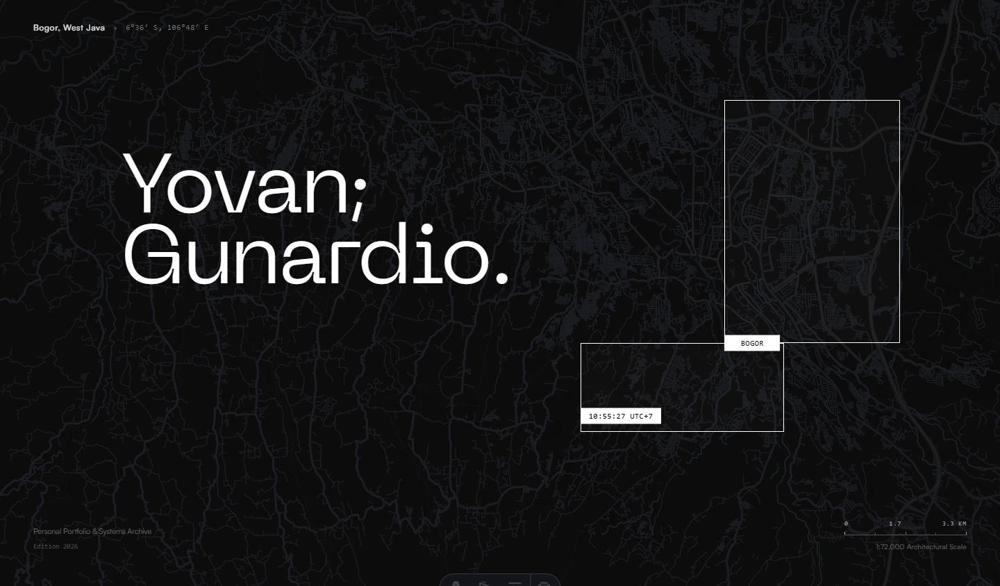
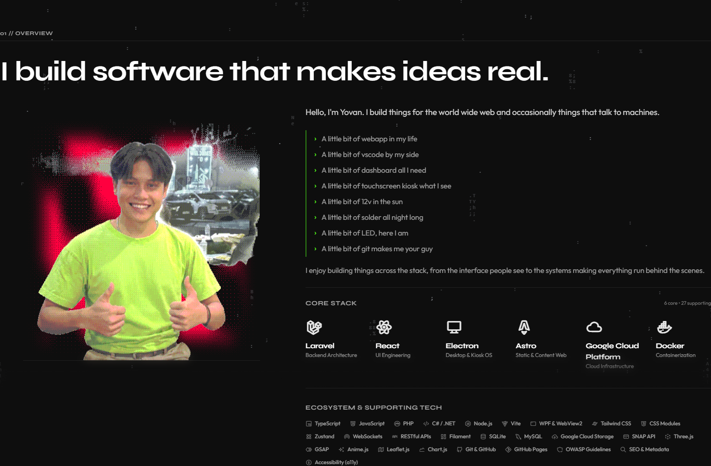
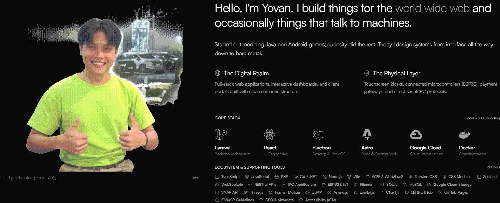
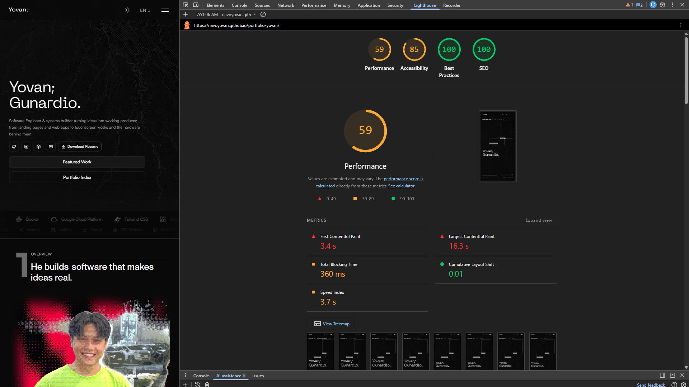
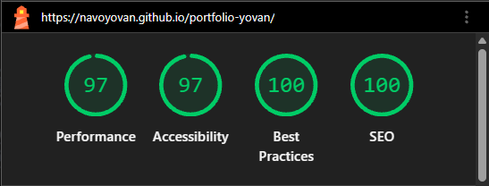
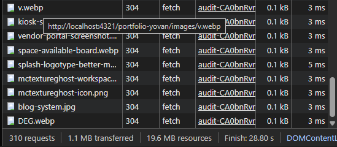
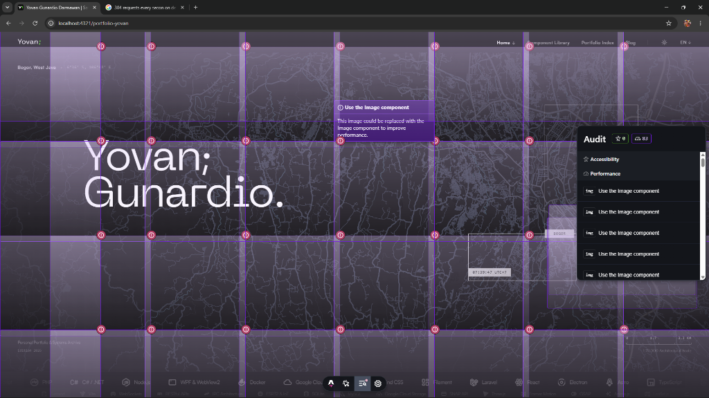

This page was never supposed to be a brutalist terminal.

That is the whole story, honestly. Everything below is just what it took to get the page to what I meant in the first place.

---

## 1. The Scaffolding

I always wanted editorial minimalist. Quiet hairline dividers. Normal hierarchy. Nothing yelling.

The early build looked like a terminal anyway, and I went along with it on purpose. I needed the whole page mapped out first. Every section, every slot, every piece of content sitting somewhere on the page. The terminal look was fast to lay down and easy to throw away, so it did the job of scaffolding.

Once the page was fully mapped, the plan flipped: curate each section off the legacy layout, one by one, top to bottom. That is where the overhaul starts, right around when the heatmap divider got prototyped on October 8.


*Early terminal layout scaffolding: raw `<yovan/>` hero, and IDE comment.*


*Current editorial layout: stripped terminal chrome, Swiss wireframe viewfinder, and calm typographic hierarchy.*

---

## 2. The Rule Underneath: Trivial Stays in the Background

This one is NOT new. It has been the rule since day 1, and every piece that fits it was built that way from the moment it was added.

Trivial stuff that would only BLOAT the page if it got a spotlight goes in the background. My GitHub heatmap. My old school and college projects. Stuff people take for granted. It is a third tier, basically an easter egg layer for whoever looks closely. Not a show-off.

### The heatmap divider

`GithubContributionDivider.astro` started with one prompt: a minimal seam between content and footer, edge to edge, no padding, no card wrapper. It wasn't meant to be a trophy piece. Just two years of raw activity compressed into a quiet divider.

Getting it to sit back took a few passes: tuning week density across breakpoints, fading it with a vertical mask so it melts into the page, and clipping hover tooltips to the viewport. It's an ongoing balance, keeping the data present without letting it shout over the footer beneath it.

### The footer and the business card detour

The footer got reworked around the divider. Along the way I prototyped a skeuomorphic tilt business card (`PersonalBusinessCard.astro`). It completely fought the quiet rhythm of the footer, so it got exiled to the component library and stayed there.

### Whispers from the lines

`EggLink` triggers sit inline in the page, like a stray hyperlink. Click one and `EasterEggs.astro` opens up dusty student prototypes, forgotten scripts, and screenshots from at least 6-BC (Before Claude).

Left inline throughout the page for anyone curious enough to click. Exactly where it belongs.

### Scrapped ASCII greebles

At one point I planned to bring back shapes from an old college console app, drawing shapes out of `*` asterisks as subtle background greebles.

Once I decided to drop the terminal aesthetic entirely, that idea went straight into the scrap bin. (Not to be confused with the interactive ASCII blob, which was already retired to the component library and planning to be published to 21st.dev.)

---

## 3. Taking the Scaffolding Down, Section by Section

Top to bottom. Strip the terminal habits, keep the structure.

* **Type.** Replaced **Syne** hero with **Neue Machina v2**. Header From **Syne** to **Satoshi**. Body moved **Outfit** to **Satoshi.** **Syne** stays for brand marks like `hype-box`.
* **Navbar.** Bottom border gone. Quiet header. The logo `<yovan/>` dropped and became `Yovan;`.
* **Hero map.** The Leaflet backdrop got pulled off the terminal look. On top sits a Swiss overlapping wireframe rectangle, perfect imperfection. The middle notch is the city label hitbox: Bogor to Greater Jakarta, with the coordinates, title, and scale ruler sliding over. The bottom notch triggers the time.
* **Overview.** "He builds..." turns into "I build..." on scroll.
* **Philosophy.** The lyrics rotator moved here from Overview. Compact two lines, active line scales up, Apple Music style.
* **Dark mode default** (`9456704`).


*Section curation before overhaul: heavy terminal boxes, hard outlines, and raw utilitarian layout.*


*Overview section after overhaul: stripped container chrome, quiet hairline dividers, and natural editorial flow.*

---

## 4. The Signature Morph Tile

A grid tile that morphs open into a detail card. That is my move. It lives in **mcTextureGhost**, **HYPE-BOX**, and now **This Portfolio**, in both the Engineering carousel and the Design Gallery bento.

### How it got here

For this one the inactive state is a pure 16:9 thumbnail. No border, no title, no container. Click it and it opens in place.

On October 10 I went through a modal, a fade-in, and a CSS scale hack. All rejected. One hard rule killed them: **the morph must NOT push anything**.

### Decoupled vs. in-place

mcTextureGhost and HYPE-BOX use a **decoupled** morph. The open card floats separately from the grid. v5 uses a new method: **in-place**. Neither one wins outright. Both have real quirks.

* **Decoupled.** Very customizable. The floating card can take any shape without breaking its neighbors. But it breaks in some specific way when the user scrolls.
* **In-place.** `.morph-card` never leaves its `.project-slot`. The slot holds a fixed footprint, the card sits `absolute` inside it, and Motion animates `width`, `height`, `top`, `left`. Scroll comes free, page and carousel, because the card is still part of the layout. The cost: you fight the DOM for every pixel.

### Fighting the DOM

* **The `420px` runway.** `overflow-x: auto` on the carousel forces vertical overflow to clip, so an opening card gets cut off. Fix: `padding-bottom: 420px; margin-bottom: -420px` on the scroll container, with `pointer-events-none` so the invisible room never eats clicks.
* **Stacking.** Opening card gets `z-index: 60`. A closing card holds `50` until it finishes, so it never drops behind a neighbor mid-close. The carousel and bento sections swap `z-index` depending on which one has the open card.
* **Edge-aware bloom.** Cards open to `125%` width. Middle cards spread `12.5%` each side. The first card opens `25%` right, the last `25%` left, so nothing clips off the edge.
* **Measure first.** Before animating, the card snaps to target width with `height: auto`, reads `scrollHeight`, restores, forces a reflow, then animates to that exact pixel height. No overshoot.

---

## 5. The Blog as the Editorial Voice

The blog started October 7 as a way to get the mcTextureGhost `v1.1.1 -> v1.1.2` performance post-mortem out of one big setup and onto the site.

It grew into the real thing:

* **Content Collections.** `blog` and `projects`, so posts can point at the work they talk about.
* **Table of contents.** `BlogOutline.astro`, modeled after the component library sidebar. Scroll-spy, H2 to H4 depth muting, a section indicator while dragging the scrollbar.
* **Multiple authors.** `AuthorAvatar.astro` credits humans and AI co-authors.
* **Stress test.** "Hello World;", a hostile sample post built to break the layout before real posts could.
* **Index and discovery.** A vertical bento index with a `Latest` badge, JSON-LD, and an RSS feed.
* **Self-reference.** The blog system is now a project tile on the home page.

Same editorial rules as the rest of the page, just applied to writing.

---

## 6. The Scoreboard: From 59 to 97

Visual polish does not mean much if the page feels sluggish.

Earlier in the build, the numbers were rough: 59 on Performance, 85 on Accessibility. The main thread was doing too much unnecessary work, and the Largest Contentful Paint sat at 16.3 seconds.


*Early baseline audit: Performance at 59 with a 16.3s LCP, and Accessibility at 85.*

Most of the drag came from familiar oversights:

* Raw screenshots dumped straight into the layout without responsive downscaling.
* Font requests competing with page rendering on first load.
* An SVG filter on the hero map forcing CPU software rasterization across the whole viewport every time Leaflet updated tiles.

Getting both Performance and Accessibility up to 97 came down to systematic cleanup:

* **Responsive assets.** Every project card now uses `srcset` and `sizes`. Mobile viewports fetch 15-30 kB variants instead of downloading 400+ kB desktop images, and the portrait in Overview stays eagerly loaded so LCP resolves right away.
* **Composited map styling.** Replaced the SVG road-suppression filter with hardware-accelerated CSS filters, keeping the Leaflet layer on the GPU.
* **Accessibility cleanup.** Removed dead interactive hitboxes, synced ARIA labels with actual visible text, and fixed low-contrast borders.


*Overhauled build: 97 Performance, 97 Accessibility, 100 Best Practices, 100 SEO.*

---

## 7. The Last Mile: Astro's Dev Toolbar DDoS'd My Localhost

One thing had been running in the background the whole time, and I knew it was there. I just saved fixing it for last.

In dev mode, my localhost was basically under a self-inflicted DDoS attack. Every second fires **Multiple requests** in the Network tab, all status `304`, all initiated by `audit-CA0bnRvr.js`, hammering my own local images (`v.webp`, `kiosk-screenshot.webp`, `vendor-portal-screenshot.webp`, `blog-system.jpg`, and the rest of `public/images/`).

 Piled up *requests on reload in dev mode: `audit-CA0bnRvr.js` firing background `fetch()` calls against every local image.*

Digging into `node_modules/astro/dist/runtime/client/dev-toolbar/apps/audit/rules/perf.js` exposed the culprit:

```javascript
{
  code: "perf-use-image-component",
  selector: "img:not([data-image-component])",
  async match(element) {
    // Fetches the raw blob of EVERY local  to check if it's over 20KB:
    const imageData = await fetch(src).then((response) => response.blob());
    if (imageData.size < 20480) return false;
    return true;
  }
}
```

Astro's Dev Toolbar Audit app grabs every `img` missing `data-image-component` and fires a background `fetch(src)` just to read `blob.size`. Worse, the audit re-runs on a `MutationObserver` attached to `document.body`, so any DOM churn triggers the whole wave again.

* **Stopping the self-DDoS (`astro:assets`):** All my site images were raw `` tags pointing at `public/images/`. Moving them into `src/assets/images/` and switching the components to Astro's `<Image />` stamped `data-image-component` natively and killed the fetch flood on the spot. It also compressed the heavy files at build time (`blog-system.jpg` dropped from `371 kB` to `52 kB`, `splash-logotype` from `226 kB` to `118 kB`, `yg.png` from `161 kB` to `2 kB`), and I nuked a duplicate `public/media/` folder while I was in there.
* **Clearing the Leaflet map noise:** The hero map's external slippy tiles (`HeroMap.astro`) were not being re-fetched (`perf.js` skips external URLs before calling `fetch`), but the same rule still flagged every single tile and painted **83 purple warning boxes** across the hero. Extending `L.TileLayer` to stamp `data-image-component="true"` and `alt=""` on tile creation shut the overlay up.

 Multiple *false-positive "Use the Image component" audit boxes painted over the external Leaflet map tiles in Hero.*

---

The scaffolding is down. The page finally resembles like what I meant.
